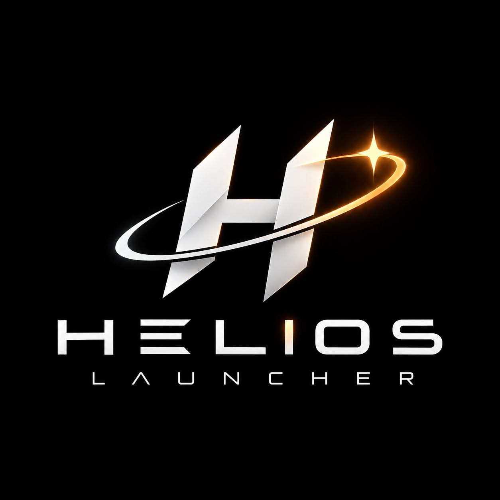

# Helios Launcher

### Anavic Studios LLC

A standalone desktop flight sandbox for staged rockets, powered aircraft, and passive orbital objects. Fly from Earth, the Moon, or Mars, watch orbital geometry change in real time, customize vehicles, and export flight telemetry. Runs offline without a service, API key, browser, or account.

<p align="center"></p>

## Get the Windows executable

1. Upload **the contents of this folder** to the root of your GitHub repository, including the hidden `.github` folder. The final workflow path must be `.github/workflows/build.yml`.
2. Open **Actions → Build Helios Launcher → Run workflow**. Pushes to `main` or `master`, pull requests, and `v*` tags also build automatically. Enable Actions if your repository has them disabled.
3. When the run succeeds, open it and download **HeliosLauncher-Windows-x64** under **Artifacts**. You must be signed in to GitHub to download artifacts.
4. Extract the entire downloaded ZIP. Run `HeliosLauncher.exe` from the extracted folder. Keep its `_internal` folder alongside the executable. This is a portable application, not an installer. Artifacts are retained for 30 days; rerun the workflow to generate a new one.

The executable is unsigned. Windows may display a publisher reputation prompt. Production distribution and signing require your own certificate. The workflow produces an artifact; it does not automatically publish a GitHub release.

Build reference: [GitHub Python workflows](https://docs.github.com/en/actions/tutorials/build-and-test-code/python), [artifact downloads](https://docs.github.com/en/actions/tutorials/store-and-share-data), and [PyInstaller bundled resource paths](https://pyinstaller.org/en/stable/runtime-information.html).

## Run from source

Requires Python **3.11 or newer with Tk 8.6+**. Windows Python installers normally include Tk. Linux may require the distribution's `python3-tk` package. No pip packages are needed to run the application.

```powershell
python main.py
```

## First launch

The Anavic Space loading screen appears before the cockpit. Select **Earth** and **Helios Two Stage**, then click **New surface flight**. Set throttle to 100%, leave pitch at 90°, and click **Resume**. Enable **Gravity-turn assist** for a simple ascent pitch program. Press **Space** when the current stage runs dry. Use **Orbit map** to see the flown trajectory and osculating orbit. The assist cuts thrust when predicted apoapsis reaches 220 km; circularization remains manual.

For an immediate orbit demonstration, select **Orbital Probe**, then **New circular orbit** and **Resume**. The starting altitude is 200 km with ideal circular inertial speed. Try the Moon for an atmosphere-free conservation experiment. Select **Aster Spaceplane** for a simplified powered aircraft with wings; launch vertically then gradually reduce pitch. Its engine stops producing thrust above 30 km. It is not a detailed jet-engine or runway model.

## Included features

- Central-body inverse-square gravity in a two-dimensional inertial plane; Earth, Moon, and Mars parameters.
- Fixed 0.02 s integration, independent of display frame rate; pause and 1–50× time acceleration.
- Wet/dry stage mass, propellant flow, specific impulse, thrust, manual separation, impact and landing states.
- Exponential atmosphere, quadratic drag, simplified wing lift, induced drag, dynamic pressure, net acceleration.
- Local-horizon pitch, throttle, simple rocket gravity-turn guidance and apoapsis cutoff.
- Follow camera and planet-centered orbit view, zoom, flown trail and osculating conic, apoapsis and periapsis.
- Live telemetry, altitude chart, mission event log, editable vehicle JSON, mission save/load and CSV export.
- Branded splash, application icon, offline runtime, automated physics tests and desktop startup smoke check.

## Controls

| Control | Action |
| --- | --- |
| P | Pause / resume |
| W / S | Increase / decrease throttle by 5% |
| A / D | Increase / decrease pitch by 3° |
| Space | Drop current stage and select next engine |
| F | Switch flight / orbit map |
| Zoom slider | Change camera scale |

Pitch is degrees above the **local prograde tangent**: 90° is outward/up, 0° is tangent, −90° is inward/down, 180° is opposite tangent. Guidance overrides the pitch slider while active. New flights start paused with zero throttle. Loading a mission pauses it. Stage separation discards any remaining propellant in the dropped stage. There is no automatic staging.

## Build locally on Windows

```powershell
python -m venv .venv
.venv\Scripts\python -m pip install -r requirements-build.txt
.venv\Scripts\python -m unittest discover -s tests -v
.venv\Scripts\python scripts/smoke_ui.py
.venv\Scripts\python -m PyInstaller --clean --noconfirm HeliosLauncher.spec
```

Output: `dist/HeliosLauncher/HeliosLauncher.exe`, with bundled dependencies in `_internal`. Build on Windows to produce Windows executables. The workflow uses Python 3.13 on the hosted Windows x64 runner. Development verification also works with Python 3.14.

## Repository map

```text
.github/workflows/build.yml    Windows tests, packaging, downloadable artifact
assets/                       Supplied logos and derived Windows icon
helios/physics.py              Headless simulation, models, save schema
helios/app.py                  Desktop cockpit, cameras, editor, telemetry
main.py                       Application entry point
HeliosLauncher.spec           PyInstaller data and executable configuration
scripts/smoke_ui.py            Real Tk widget / camera startup verification
tests/test_physics.py         Flight dynamics and persistence regression tests
docs/                         Modeling notes, vehicle format, flight exercises
examples/                     Editable vehicle configurations
```

See [the flight manual](docs/FLIGHT_MANUAL.md), [physics and architecture](docs/PHYSICS.md), and [vehicle format](docs/VEHICLES.md). This is an educational **2D sandbox**, not a certified engineering tool or a 3D aerospace suite. It does not implement n-body dynamics, terrain, detailed engine chemistry, structural mechanics, multiplayer, or a graphical part assembly editor.

## Attribution and ownership

Created for **Anavic Studios LLC**. The supplied Anavic Space and Helios Launcher logo images are included unchanged; the ICO is derived from the supplied Helios image. No third-party art or fonts are bundled. See `LICENSE` for the default proprietary distribution terms. Replace those terms before publishing if you intend to grant an open-source license.
